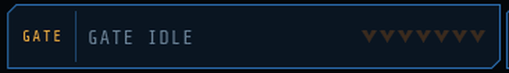
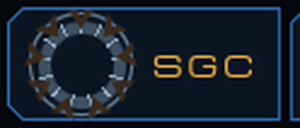
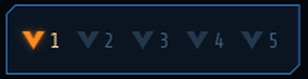
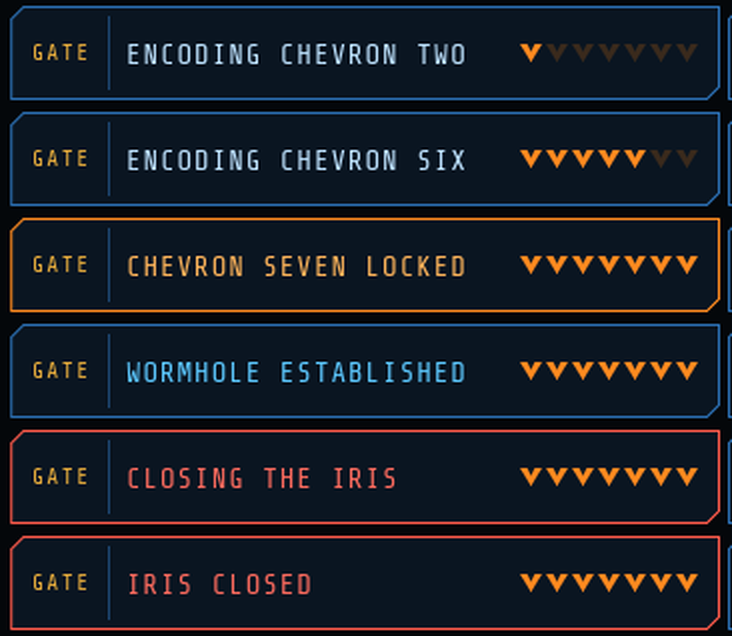
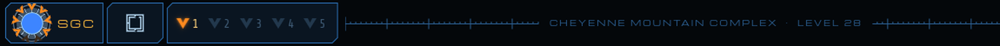
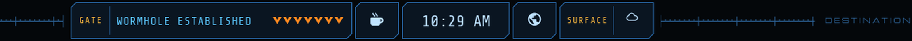
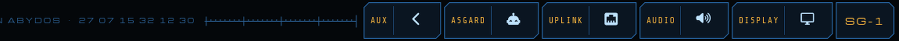

# Stargate SG-1 extras for Omarchy

Optional add-ons for the
[Stargate SG-1 Omarchy theme](https://github.com/vwillcox/omarchy-stargate-sg1-theme):
the SGC bar, the gate wallpaper played in step with the bar, and the
scripts that build the theme's wallpapers and sounds. Omarchy themes can't
ship code, so these live here and you install them yourself.

- **SGC bar** (a skinned clone of Omarchy's own bar). It looks like a
  dialing-computer console: cut-corner panels framed in event-horizon blue,
  with amber labels (UPLINK, ASGARD, NAQUADAH, SURFACE…) and Michroma / Share
  Tech Mono lettering.
  - Workspaces are gate chevrons. The focused one glows and engages when it
    locks, and clicking one plays a DHD press.
  - The left cap holds a miniature stargate. Next to the clock is a
    gate-status readout ("ENCODING CHEVRON FOUR", "CHEVRON SEVEN LOCKED",
    "WORMHOLE ESTABLISHED", a blinking red "CLOSING THE IRIS", …) with seven
    chevron pips.
  - Both stay in step with the wallpaper: the bar reads the video's playback
    position from mpv and plays the same timeline the loop was rendered from.
    With the video off, the gate rests.
- **Gate wallpaper, synced.** The theme's `backgrounds/gate-loop.mp4` played
  with mpvpaper, so the bar can follow it. It starts when the theme is
  applied and after login, and stops when you switch away.
- **Dial on apply.** The gate dials once (sound) as the theme comes up.
- **Build tools** (`tools/`) for the gate video, the still, the bar and the
  sounds.

## The bar in action

Captured from the live bar at 3440×1440 and enlarged; the GIFs play in real
time.

The gate-status readout over one full 53 s loop of the wallpaper, from the
first chevron to the wormhole shutting down:



| Miniature stargate in the left cap, same loop | Workspace chevrons engaging as the focus moves |
|---|---|
|  |  |

Readout states, top to bottom: encoding, encoding with five chevrons lit,
chevron seven locked, wormhole established, closing the iris, iris closed.



The whole bar, left to right, with the wormhole established:





## Install

Install the theme first. The extras use its video and sounds:

```bash
omarchy theme install https://github.com/vwillcox/omarchy-stargate-sg1-theme
omarchy pkg aur add mpvpaper      # plays the video wallpaper
git clone https://github.com/vwillcox/omarchy-stargate-sg1-extras
omarchy-stargate-sg1-extras/install.sh
```

Read `install.sh` before you run it. It's short, and it installs:

| What | Where |
|------|-------|
| SGC bar plugin, built from your own Omarchy's stock bar | `~/.config/omarchy/plugins/vwillcox.sgc-bar/` |
| Theme-set hook: swaps the bar in and out, starts and stops the video | `~/.config/omarchy/hooks/theme-set.d/stargate-sg1.sh` |
| Post-boot hook: brings the video back after login | `~/.config/omarchy/hooks/post-boot.d/stargate-sg1.sh` |
| `omarchy-sgc-gate-toggle` and `omarchy-video-wallpaper-guard` | `~/.local/bin/` |
| Michroma and Share Tech Mono fonts | `~/.local/share/fonts/sgc/` |

If the theme is already active, the script re-applies it so the gate and the
bar come up straight away.

Good to know:

- **Your bar comes back.** Switching to another theme restores whichever bar
  you had before, stock or your own plugin.
- **After an Omarchy update**, re-run `install.sh` to rebuild the bar from
  the updated stock bar. If the stock bar has changed too much for the patch
  to apply, the script installs the bundled copy and tells you.
- **Keep the still selected as your Omarchy background** (`1-gate.webp`, the
  theme's default). The theme also offers `gate-loop.mp4` as an Omarchy
  background, but with the extras installed mpvpaper is already playing it.
  Selecting it in Omarchy as well would decode the video twice.
- **The video is 3440×1440** (21:9) at 30 fps. On 16:9 screens it fills the
  screen by trimming the sides; the gate stays centred. mpv decodes it on
  the GPU where it can.
- `omarchy-sgc-gate-toggle [on|off|toggle|restart]` controls the video by
  hand. The guard it starts restarts the video when a monitor hotplug or a
  shell restart leaves the static background stacked on top of it.

Requirements: Omarchy with the Quickshell-based shell, the stargate-sg1
theme, `mpvpaper`, and `pw-play` (PipeWire) for the sounds. `jq` and `socat`
ship with Omarchy.

## Uninstall

Switch to another theme first (that hands the bar back and stops the video),
then delete the files in the table above.

## Rebuilding the theme's media

Everything in the theme is reproducible from `tools/`. You need Blender 5.x
(Cycles; an RTX card renders a frame in about 10 s), Python with `numpy` and
`OpenEXR`, `ffmpeg` and ImageMagick. `THEME` is your clone of the theme
repository.

```bash
python3 tools/sgc_timeline.py          # print the schedule (all timings live here)

# frames: ~1200 unique of 1601 at 3440x1440
blender -b --factory-startup -P tools/sgc_gate.py -- OUT --skip-existing
python3 tools/gate_compose.py OUT "$THEME/backgrounds/gate-loop.mp4"
python3 tools/gate_compose.py OUT --still still.png --still-frame 960
magick still.png -strip -resize '3840>' -quality 82 "$THEME/backgrounds/1-gate.webp"

# bar: re-skin a fresh copy of the stock bar, regenerate the timeline
cp -r /usr/share/omarchy/shell/plugins/bar /tmp/sgc-bar
python3 tools/patch_sgc_bar.py /tmp/sgc-bar
python3 tools/gen_gate_js.py /tmp/sgc-bar/GateTimeline.js

python3 tools/sgc_sounds.py "$THEME/sounds"
```

Faster checks: `--scale 25 --samples 24` renders the whole loop in about
7 minutes, `--preview` renders only the motion in Workbench, and
`--look 28.3,40` renders single moments. If you change the timeline,
re-render and regenerate `GateTimeline.js` together so the bar stays in step.

If you fork the theme, keep its repository name ending in
`stargate-sg1-theme`: Omarchy names the theme after the repo, and these
scripts look for `~/.config/omarchy/themes/stargate-sg1`.

## License and credits

MIT licensed; see `LICENSE`.

Fonts: [Michroma](https://fonts.google.com/specimen/Michroma) and
[Share Tech Mono](https://fonts.google.com/specimen/Share+Tech+Mono), both
under the SIL Open Font License (`fonts/`).

Stargate SG-1 is a trademark of MGM. This is a non-commercial fan project,
not affiliated with or endorsed by MGM.
